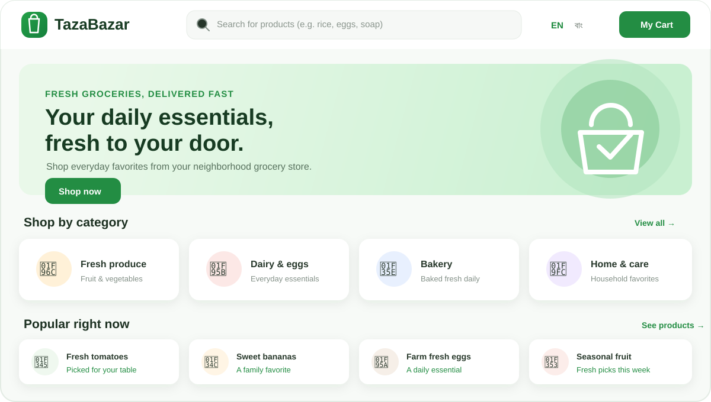

# TazaBazar

TazaBazar is a grocery e-commerce storefront inspired by the online shopping experience in Bangladesh. Shoppers can browse product categories, search, manage a cart, and place orders.



## Features

- Responsive grocery storefront with category browsing, search, deals, and popular products
- English and Bengali interface
- Product details, shopping cart, checkout, and order history
- Account registration, login, and customer support chat

## Tech stack

- React, TypeScript, Vite, and Tailwind CSS
- Express API with PostgreSQL and Drizzle ORM
- pnpm workspace monorepo

## Run locally

Requirements: Node.js 22 or newer, pnpm, and PostgreSQL.

```bash
pnpm install
pnpm run typecheck
pnpm run build
```

Start the storefront:

```bash
pnpm --filter @workspace/tazabazar dev
```

Open [http://localhost:5173](http://localhost:5173). The storefront uses the API for product data, accounts, carts, and orders. To use those features, configure `DATABASE_URL` and `SESSION_SECRET` for the API server and initialize the database schema.

## GitHub Pages preview

The GitHub Actions workflow builds and deploys a static storefront preview when changes are pushed to `main`. Enable **Settings → Pages → Build and deployment → Source → GitHub Actions** in the repository to publish it.

GitHub Pages hosts only the frontend. API-backed features such as product data, login, cart persistence, and order placement require a separately hosted API and PostgreSQL database.
